<p align="center">
  
</p>

<h1 align="center">gknowledge</h1>

<p align="center"><a href="README.md">English</a> · <a href="README.zh-CN.md">简体中文</a> · <b>Italiano</b> · <a href="README.fr.md">Français</a> · <a href="README.pt-BR.md">Português (BR)</a> · <a href="README.es.md">Español</a></p>

<p align="center">
  <b>La LLM Wiki di Karpathy come app nativa GNOME.</b><br>
  Trascina i tuoi documenti e ottieni una wiki collegata che un modello tiene aggiornata.<br>
  Offline per impostazione predefinita, Markdown semplice su disco, compatibile con Obsidian.
</p>

<p align="center">
  <a href="LICENSE"></a>
  
  
  <a href="https://github.com/openapi/gknowledge/releases/latest"></a>
</p>

<p align="center">
  
</p>

## Installazione

Su Ubuntu 24.04+ e Debian 13+ basta una riga: aggiunge il repository APT firmato di gknowledge, così gli aggiornamenti arrivano con `apt upgrade` (sulle altre distribuzioni installa in `~/.local`):

```bash
curl -fsSL https://github.com/openapi/gknowledge/releases/latest/download/install.sh | bash
```

Oppure aggiungi tu il repository APT:

```bash
sudo curl -fsSLo /usr/share/keyrings/gknowledge.gpg https://openapi.github.io/gknowledge/gknowledge.gpg
sudo curl -fsSLo /etc/apt/sources.list.d/gknowledge.sources https://openapi.github.io/gknowledge/gknowledge.sources
sudo apt update && sudo apt install gknowledge
```

Su qualsiasi distribuzione, con Flatpak (il runtime GNOME arriva da Flathub):

```bash
flatpak install --user https://openapi.github.io/gknowledge/io.gknowledge.Gknowledge.flatpakref
```

## Perché gknowledge

Se hai usato [LLM Wiki](https://github.com/nashsu/llm_wiki), [Tolaria](https://github.com/refactoringhq/tolaria), [Reor](https://github.com/reorproject/reor) o [Khoj](https://github.com/khoj-ai/khoj), conosci già il ciclo: **importi le fonti, il modello costruisce e mantiene una wiki, poi fai domande alla wiki.** gknowledge lo fa come vera applicazione GNOME.

- **Nativa**, GTK 4 e Libadwaita: niente Electron, Tauri o browser incorporato.
- **Funziona senza account**: un motore offline importa e risponde; un modello lo migliora.
- **I dati restano tuoi**: Markdown con frontmatter YAML e un indice SQLite leggibile. La cartella si apre in Obsidian.
- **Con fonti e revisione**: ogni pagina registra le fonti, ogni risposta le cita, una coda di revisione ti lascia il controllo.

## Usala da Claude Code, Codex o Cursor

```bash
claude mcp add gknowledge -- gknowledge-mcp ~/Knowledge/mio-progetto
```

L'agente può cercare nella wiki, leggere le pagine, fare domande con citazioni e aggiungere nuove fonti.

## Scegli il cervello

| Provider | Serve | Note |
|---|---|---|
| **Offline** (predefinito) | niente | Estrazione euristica, completamente privata |
| **Piano ChatGPT** | account Plus o Pro | In Preferenze, *Sign in with ChatGPT*: i consumi vanno sul tuo piano, nessuna chiave API |
| **Ollama / LM Studio** | un server locale | Qualsiasi endpoint compatibile OpenAI |
| **Cloud** | una chiave API | OpenAI, OpenRouter e simili |

Il resto della documentazione è nel [README in inglese](README.md). Se gknowledge ti è utile, una ⭐ aiuta altri utenti GNOME a trovarlo.
